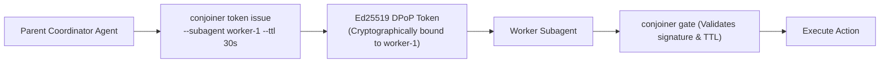

# Recipe: Ephemeral DPoP Delegation for Autonomous Subagents

> **Use Case ID:** `CNJ-UC-01`  
> **Target Audience:** Multi-Agent Orchestrators, Systems Architects, Security Engineers  
> **Platform Mechanism:** RFC 9449 Ed25519 Demonstrating Proof-of-Possession (DPoP)  

---

## 1. Problem Statement

When a coordinator agent delegates a task to an autonomous subagent (e.g. running a database migration or editing a specific component), granting the subagent broad long-lived API tokens violates least privilege. If the subagent is compromised via prompt injection, the attacker inherits full authority indefinitely.

---

## 2. When to Use This

Use **Ephemeral DPoP Delegation** whenever a parent agent spawns a subagent. Conjoiner issues an Ed25519 DPoP JWT bound to the subagent's ephemeral keypair, with a strict 30-second TTL. The token can only be used by the entity holding the private key and expires automatically.

---

## 3. Architecture & Dataflow



---

## 4. Prerequisites

1. **Conjoiner Installed:** `brew install bonjoski/tap/conjoiner` (or built from source).

---

## 5. Step-by-Step Recipe

### Step 1: Issue a Delegated Subagent Token
```bash
# Issue an ephemeral token valid for 30 seconds
TOKEN=$(conjoiner token issue \
  --subagent "worker-42" \
  --scopes "git:read,fs:write" \
  --ttl 30s)
```

### Step 2: Pass Token to Subagent Execution
The subagent provides the token when executing privileged tool calls:
```bash
conjoiner gate --token "$TOKEN" -- action git commit -m "refactor"
```

### Step 3: Instant Revocation
If the subagent exhibits unexpected behavior, revoke the token immediately:
```bash
conjoiner token revoke --subagent "worker-42"
```

---

## 6. Verification & Expected Output

Attempting to reuse the token after 30 seconds fails closed:
```bash
sleep 31 && conjoiner gate --token "$TOKEN" -- echo "test"
```
Output:
```text
🚨 CONJOINER GATE DENIAL: Token 'tok_9f1a28' has EXPIRED (TTL: 30s exceeded).
```

---

## 7. Security Invariants & Blast Radius

- **Cryptographic Binding:** Stealing the bearer token is useless without the ephemeral Ed25519 private key.
- **Fail-Closed Gate:** Missing signatures or clock skew beyond 5 seconds cause immediate denial.

---

## 8. Troubleshooting & Common Pitfalls

- **Issue:** Subagent task takes 45 seconds and fails at the end.  
  **Remediation:** Subagent can request an attenuated renewal before the 30s window closes if permitted by policy:
  ```bash
  conjoiner token renew --token "$TOKEN"
  ```
