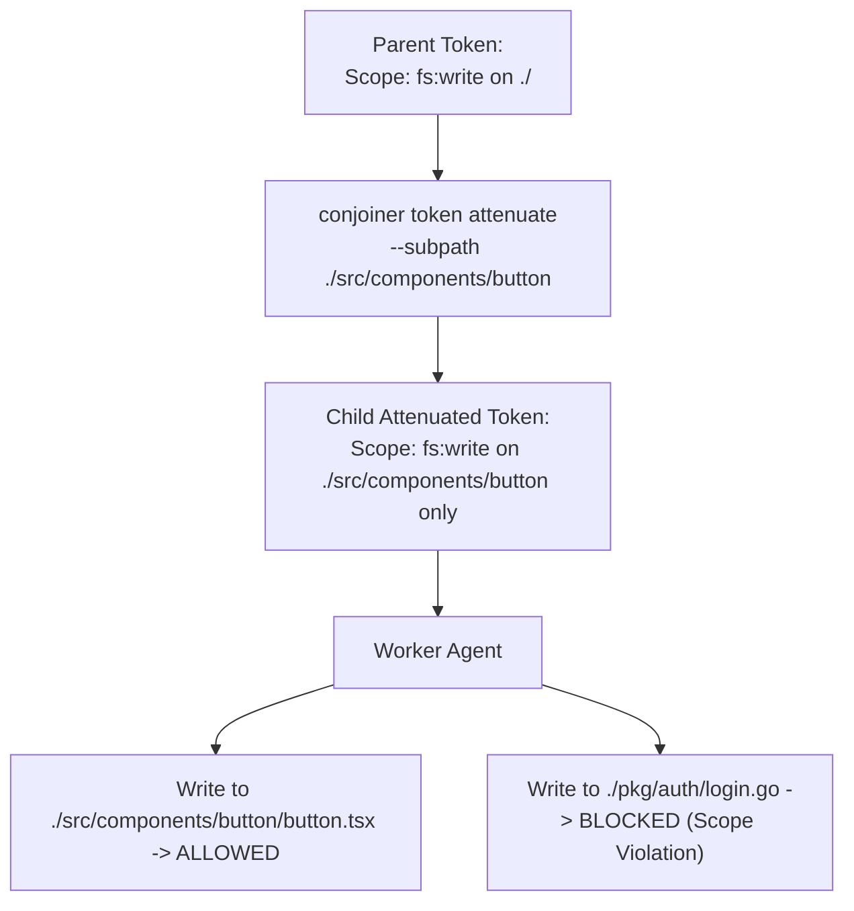

# Recipe: Path-Restricted Capability Attenuation

> **Use Case ID:** `CNJ-UC-02`  
> **Target Audience:** Multi-Agent Developers, Workspace Isolation Architects  
> **Platform Mechanism:** Monotonic Capability Attenuation & Path Scoping  

---

## 1. Problem Statement

A parent agent has permission to modify the entire repository (`/Users/username/code/project`), but wishes to delegate the styling of a single frontend button to a worker subagent. Granting the worker write access to the entire root directory allows a compromised worker to overwrite backend authentication logic or CI workflows.

---

## 2. When to Use This

Use **Path-Restricted Attenuation** to derive a monotonically attenuated token. Conjoiner verifies that the new token *strictly restricts* the parent token's capabilities (e.g. limiting writes exclusively to `./src/components/button`).

---

## 3. Architecture & Dataflow



---

## 4. Prerequisites

1. **Conjoiner CLI:** Available on `$PATH`.
2. **Active Parent Token:** Minted via `conjoiner token issue`.

---

## 5. Step-by-Step Recipe

### Step 1: Attenuate Parent Token to Specific Subdirectory
```bash
CHILD_TOKEN=$(conjoiner token attenuate \
  --token "$PARENT_TOKEN" \
  --restrict-path "./src/components/button" \
  --ttl 60s)
```

### Step 2: Subagent Attempts Execution
```bash
# Permitted: Write inside scoped path
conjoiner gate --token "$CHILD_TOKEN" -- write "./src/components/button/button.tsx"

# Prohibited: Write outside scoped path
conjoiner gate --token "$CHILD_TOKEN" -- write "./backend/server.go"
```
Output:
```text
🚨 CONJOINER GATE DENIAL: Operation violates path restriction.
Target: './backend/server.go' is outside allowed subpath: './src/components/button'
```

---

## 6. Verification & Expected Output

Inspect token attenuation lineage:
```bash
conjoiner token inspect --token "$CHILD_TOKEN"
```
Shows parent ID, derived attenuation constraints, and expiration timestamp.

---

## 7. Security Invariants & Blast Radius

- **Monotonic Attenuation:** A subagent can only further restrict its permissions; it can never elevate or broaden its scope.

---

## 8. Troubleshooting & Common Pitfalls

- **Issue:** Attempting to attenuate to a path outside the parent's boundary fails.  
  **Remediation:** Conjoiner enforces strict subpath matching; ensure the requested subpath is a canonical descendant.
