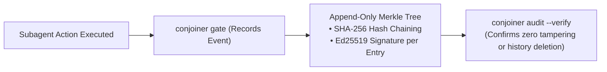

# Recipe: Cryptographic Intent Ledger Verification

> **Use Case ID:** `CNJ-UC-03`  
> **Target Audience:** Compliance Officers, Security Auditors, Multi-Agent Supervisors  
> **Platform Mechanism:** Merkle Tree Audit Ledger & Ed25519 Signatures  

---

## 1. Problem Statement

Autonomous agents perform hundreds of actions (git commits, dependency additions, API calls) without human eyes on every command. If a bug, data leak, or rogue agent action is discovered, determining *which* subagent took the action and *why* requires an immutable audit trail.

---

## 2. When to Use This

Use the **Cryptographic Intent Ledger** to record every tool invocation, delegation event, and capability check. Conjoiner signs each entry into an append-only Merkle ledger on localhost (`~/.conjoiner/ledger.db`), providing tamper-evident forensic attribution.

---

## 3. Architecture & Dataflow



---

## 4. Prerequisites

1. **Conjoiner Installed:** Version 1.0+ on `$PATH`.

---

## 5. Step-by-Step Recipe

### Step 1: Audit Recent Subagent Activities
```bash
conjoiner audit --last 10
```
Expected output:
```text
📜 Conjoiner Cryptographic Intent Ledger (Recent 10 Events):
[2026-11-18 15:40:02] MINT_TOKEN      | Subagent: worker-42 | Scopes: [fs:write] | Parent: coordinator
[2026-11-18 15:40:15] EXECUTE_TOOL    | Subagent: worker-42 | Action: edit_file(button.tsx) | Result: ALLOWED
[2026-11-18 15:40:22] GATE_DENIAL     | Subagent: worker-42 | Action: read(/etc/passwd) | Result: DENIED
```

### Step 2: Verify Cryptographic Integrity
```bash
conjoiner audit --verify
```
Expected output:
```text
✅ LEDGER INTEGRITY VERIFIED
   • Total Entries: 142
   • Merkle Root:   7f9a2b0c3d4e5f6a1b2c3d4e5f6a7b8c
   • Cryptographic Signatures: 100% VALID (Zero tampering detected)
```

---

## 6. Verification & Expected Output

Attempting to manually alter entries in `~/.conjoiner/ledger.db` causes `conjoiner audit --verify` to report `TAMPERING DETECTED: Merkle root mismatch at block #42`.

---

## 7. Security Invariants & Blast Radius

- **Tamper Evidence:** Any modification to past ledger entries breaks the SHA-256 cryptographic chain.
- **Attribution Non-Repudiation:** Every action is signed with the subagent's DPoP private key.

---

## 8. Troubleshooting & Common Pitfalls

- **Issue:** Ledger file grows too large.  
  **Remediation:** Export and archive signed checkpoints using `conjoiner audit archive`.
